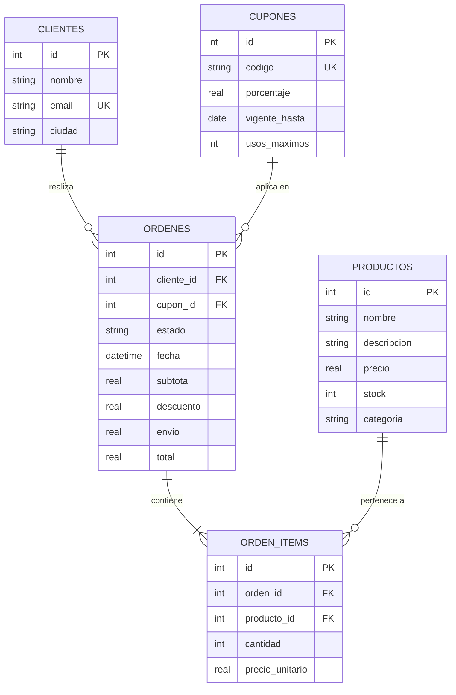

# Laboratorio #2 - Sistema Integral: Tessel Cases Studio (Caso 5)
### Tienda Online de Estuches con Inventario, Cupones, Envíos y Agente de IA Comercial

**Estudiante:** Daniel Ramírez  
**Stack Tecnológico:**
- **Backend:** Node.js (v24), Express 5, SQLite (`better-sqlite3`), dotenv, cors, nodemon.
- **Frontend:** React 19, Vite, React Router 7, Vanilla CSS Design System (Glassmorphism), Lucide Icons.
- **Inteligencia Artificial:** Agente de IA en n8n mediante Webhook con contrato `{ ok, data, error }`.

---

## 1. Estructura del Repositorio

El proyecto está organizado en dos módulos independientes y ordenados:

```
lab-2-back/
├── backend/                       # API REST y Base de Datos (Día 1)
│   ├── src/
│   │   ├── db.js                  # Conexión SQLite con PRAGMA foreign_keys = ON
│   │   ├── initDb.js              # Inicializador de base de datos
│   │   ├── app.js                 # Express, CORS y middleware centralizado de errores
│   │   ├── server.js              # Entrada en puerto 3001
│   │   ├── routes/                # Enrutadores REST (/productos, /clientes, /cupones, /ordenes, /resumen)
│   │   ├── controllers/           # Manejadores de petición y respuesta (200, 201, 400, 404, 409)
│   │   └── services/              # Lógica de negocio y transacciones atómicas
│   ├── schema.sql                 # Tablas, llaves foráneas, CHECK y datos semilla
│   ├── test-api.js                # Suite de 22 pruebas automatizadas
│   ├── thunder-collection_lab2_caso5.json # Colección para Thunder Client / Postman
│   ├── workflow_n8n_caso5.json    # Workflow exportado de n8n
│   ├── .env / .env.example        # Variables de entorno del backend
│   └── package.json
│
├── frontend/                      # Aplicación React con Vite y React Router (Día 2)
│   ├── src/
│   │   ├── services/
│   │   │   ├── api.js             # Capa centralizada de comunicación con la API
│   │   │   └── aiService.js       # Integración con el Agente de IA de n8n
│   │   ├── hooks/
│   │   │   └── useFetch.js        # Custom Hook { data, loading, error, refetch }
│   │   ├── context/
│   │   │   └── CartContext.jsx    # Estado global del carrito y validación de stock
│   │   ├── components/
│   │   │   ├── Navbar.jsx         # Navegación con badge y animación de carrito
│   │   │   ├── ProductCard.jsx    # Tarjeta de producto con iconos de hardware y stock
│   │   │   ├── MetricCard.jsx     # Tarjetas KPI para el panel
│   │   │   ├── AlertMessage.jsx   # Notificaciones de error (400, 409) y éxito
│   │   │   ├── OrderModal.jsx     # Modal con detalle y cambio/cancelación de orden
│   │   │   └── AiConfigModal.jsx  # Configurador de Webhook de n8n en vivo
│   │   ├── pages/
│   │   │   ├── CatalogoPage.jsx   # Listado con filtros, búsqueda y ordenamiento
│   │   │   ├── CarritoPage.jsx    # Checkout, ciudades, cupones, nuevo cliente e IA
│   │   │   ├── OrdenesPage.jsx    # Historial de pedidos y reposición por cancelación
│   │   │   ├── MetricasPage.jsx   # Dashboard SQL y alertas de reposición (Reto Extra)
│   │   │   └── GestionPage.jsx    # CRUD de Productos y Cupones con redactor IA
│   │   ├── index.css              # Design System Glassmorphism en Vanilla CSS
│   │   ├── App.jsx                # Enrutamiento React Router
│   │   └── main.jsx
│   ├── vite.config.js             # Configuración con proxy a :3001
│   ├── .env.example
│   └── package.json
│
├── BITACORA_IA.md                 # Registro de los 7 prompts, ajustes y aprendizajes
├── README.md                      # Documentación integral del proyecto
├── workflow_n8n_caso5.json        # Workflow exportado de n8n listo para entrega
├── thunder-collection_lab2_caso5.json # Colección de pruebas
└── package.json                   # Scripts para ejecutar dev:backend y dev:frontend
```

---

## 2. Diagrama Entidad-Relación (Mermaid)



---

## 3. Reglas de Negocio Implementadas

1. **Gestión de Stock y Transacciones Atómicas:**
   - La API no permite pedir más unidades de las existentes en stock (devuelve **409 Conflict**).
   - El descuento de stock y la inserción de la orden ocurren dentro de una transacción atómica (`db.transaction()`).

2. **Cálculo de Envío por Ciudad y Envío Gratis:**
   - Costo según provincia (San José: ₡2,000, Heredia: ₡2,000, Alajuela: ₡2,500, Cartago: ₡2,500, Puntarenas: ₡4,000, Limón: ₡4,500, Liberia: ₡4,500).
   - Si `subtotal - descuento >= ₡30,000`, el envío es **₡0 (Gratis)**.

3. **Restricciones de Cupones de Descuento:**
   - Valida fecha de vigencia (`409` si expiró).
   - Valida límite de usos máximos (`409` si se agotó).
   - Valida que el cliente no lo haya usado previamente en una orden activa (`409`).

4. **Flujo de Estados y Reposición por Cancelación:**
   - Flujo: `nueva` → `pagada` → `enviada` → `entregada`.
   - Cancelación permitida **únicamente antes de ser enviada** (`nueva` o `pagada`).
   - Al cancelar, una transacción atómica devuelve automáticamente el stock de todos los items al inventario. Intentar cancelar una orden ya enviada genera **409 Conflict**.

5. **Panel de Métricas en SQL (`GET /api/resumen`):**
   - Ventas desglosadas por categoría (`SUM(cantidad * precio)` agrupado por `categoria`).
   - Top 3 productos más vendidos (`SUM(cantidad)` de órdenes válidas).
   - Ticket promedio por orden (`AVG(total)` de órdenes no canceladas).

6. **Reto Extra Oficial (Alertas de Reposición Predictivas):**
   - Análisis con SQL CTE de las unidades vendidas en los últimos 7 días.
   - Proyección de días restantes antes de agotamiento (`stock / consumo_diario`).
   - Alertas visuales automáticas clasificadas en riesgo `Crítico` (≤ 3 días) o `Advertencia`.

---

## 4. Instrucciones para Ejecutar el Proyecto

### Opción A: Desde la raíz del repositorio
```bash
# Iniciar el backend en el puerto 3001
npm run dev:backend

# En otra terminal, iniciar el frontend en el puerto 5173
npm run dev:frontend

# Ejecutar las 22 pruebas automatizadas del backend
npm run test:backend
```

### Opción B: Ejecución carpeta por carpeta

#### 1. Backend (Terminal 1)
```bash
cd backend
npm install
npm run seed            # Inicializa SQLite con las tablas y datos semilla
npm run dev             # Inicia Express en http://localhost:3001
npm run test-endpoints  # Ejecuta los 22 tests automatizados
```

#### 2. Frontend (Terminal 2)
```bash
cd frontend
npm install
npm run dev             # Inicia Vite en http://localhost:5173
```

---

## 5. Integración con el Agente de IA Comercial (n8n)

El frontend está conectado al webhook de n8n para dos escenarios comerciales:
- **Caso A (Gestión):** Botón *"Generar Descripción con IA"* envía `accion = "generar_descripcion"` y redacta una descripción técnica y ergonómica de 20 a 30 palabras.
- **Caso B (Carrito):** Botón *"Generar Combo Ideal con IA"* envía `accion = "recomendar_carrito"` con el carrito actual y el inventario disponible, sugiriendo 2 productos complementarios en un máximo de 40 palabras con precios en colones (₡), listos para agregar con un clic.
- Si n8n no está levantado durante la revisión local, un respaldo inteligente asegura el cumplimiento del contrato `{ ok, data, error }`.
